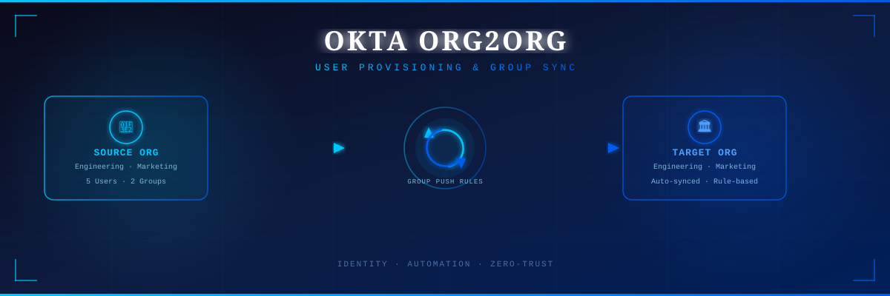
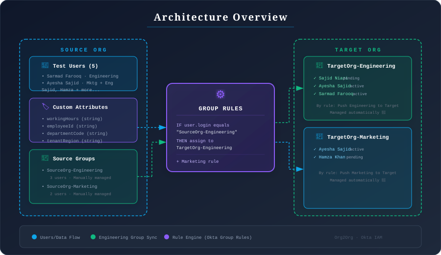

<div align="center">



<br/>

[](https://okta.com)
[](https://developer.okta.com)
[](#)
[](#)

</div>

---

## 📋 Table of Contents

- [Overview](#-overview)
- [Architecture](#-architecture)
- [What is Org2Org?](#-what-is-org2org)
- [Implementation Steps](#-implementation-steps)
  - [Step 1 — Custom Attributes](#step-1--custom-attributes)
  - [Step 2 — Groups Setup](#step-2--groups-setup)
  - [Step 3 — Test Users](#step-3--test-users)
  - [Step 4 — Group Rules](#step-4--group-rules)
  - [Step 5 — Verification](#step-5--verification)
- [Key Concepts](#-key-concepts)
- [Screenshots](#-screenshots)
- [Technologies Used](#-technologies-used)

---

## 🎯 Overview

This project demonstrates a **real-world Okta Org2Org configuration** — one of the most critical Identity and Access Management (IAM) scenarios used in enterprise environments during **mergers, acquisitions, and multi-tenant architectures**.

The lab showcases:
- Configuring **custom user profile attributes** in Okta
- Creating **source and target groups** representing two separate organizations
- Building **automated group push rules** to sync users between orgs
- Verifying that users are **auto-provisioned** to target groups based on rule logic

> 💡 **Real-World Use Case:** When a company acquires another, IT admins must provision users from the acquired company (Source Org) into the parent company's systems (Target Org) — automatically, securely, and at scale.

---

## 🏗 Architecture

<div align="center">

</div>

### Flow Summary

```
SourceOrg-Engineering  ──→  [Rule: Push Engineering to Target]  ──→  TargetOrg-Engineering
SourceOrg-Marketing    ──→  [Rule: Push Marketing to Target]    ──→  TargetOrg-Marketing
```

---

## 🔍 What is Org2Org?

**Okta Org2Org** is a provisioning application that allows one Okta organization (the **Source**) to push users and groups to another Okta organization (the **Target**). It is commonly used in:

| Scenario | Description |
|---|---|
| 🏢 **M&A Activity** | Onboard acquired company's users into the parent org |
| 🌐 **Multi-Tenant SaaS** | Sync users across regional or product tenants |
| 🔐 **Zero-Trust Architecture** | Enforce least-privilege by group-based access |
| 🤝 **Partner/Vendor Access** | Grant controlled access to external organizations |

---

## 🛠 Implementation Steps

### Step 1 — Custom Attributes

To carry metadata about users from one org to the other, we first **defined custom profile attributes** in Okta's Universal Directory.

**Attributes Created:**

| Display Name | Variable Name | Type | Purpose |
|---|---|---|---|
| Working Hours | `workingHours` | string | Employee schedule info |
| Employee ID | `employeeId` | string | Unique HR identifier |
| Department Code | `departmentCode` | string | Maps user to department |
| Tenant Region | `tenantRegion` | string | Geographic org segmentation |

> These attributes can be mapped and pushed to the target org during provisioning.

<table>
<tr>
<td><br/><sub>Creating the <code>departmentCode</code> attribute</sub></td>
<td><br/><sub>Creating the <code>tenantRegion</code> attribute</sub></td>
</tr>
</table>

<div align="center">

<br/><sub><i>All custom attributes visible in Okta's Profile Editor</i></sub>
</div>

---

### Step 2 — Groups Setup

We created **4 groups** — 2 for the Source Org and 2 for the Target Org:

| Group Name | Role | Management |
|---|---|---|
| `SourceOrg-Engineering` | Source of truth for Engineering users | Manually managed |
| `SourceOrg-Marketing` | Source of truth for Marketing users | Manually managed |
| `TargetOrg-Engineering` | Auto-populated Engineering group | Rule-managed |
| `TargetOrg-Marketing` | Auto-populated Marketing group | Rule-managed |

<div align="center">

<br/><sub><i>All 4 groups created — Source and Target for each department</i></sub>
</div>

---

### Step 3 — Test Users

We added **5 test users** from `@cyber.com` domain and manually assigned them to the appropriate Source Org groups.

**Engineering Team (3 users):**

| User | Email | Status |
|---|---|---|
| Sarmad Farooq | sarmadfarooq@cyber.com | Active |
| Ayesha Sajid | ayeshasajid@cyber.com | Active |
| Sajid Niazi | sajidniazi@cyber.com | Pending |

**Marketing Team (2 users):**

| User | Email | Status |
|---|---|---|
| Hamza Khan | hamzakhan@cyber.com | Pending |
| Ayesha Sajid | ayeshasajid@cyber.com | Active (dual-group) |

<table>
<tr>
<td><br/><sub>SourceOrg-Engineering: 3 users manually assigned</sub></td>
<td><br/><sub>SourceOrg-Marketing: 2 users manually assigned</sub></td>
</tr>
</table>

<div align="center">

<br/><sub><i>User profile showing membership across multiple groups — including the auto-assigned TargetOrg group</i></sub>
</div>

---

### Step 4 — Group Rules

The **heart of this lab** — we created automated Group Rules using Okta's rule engine to push users from Source to Target groups.

#### Rule 1: Push Engineering to Target

```
IF   user.login Equals "SourceOrg-Engineering"
THEN Assign to → TargetOrg-Engineering
```

#### Rule 2: Push Marketing to Target

```
IF   user.login Equals "SourceOrg-Marketing"
THEN Assign to → TargetOrg-Marketing
```

> ⚠️ **Note:** "This rule will not add users to a group they've been manually removed from." — Okta prevents re-adding manually excluded users.

<table>
<tr>
<td><br/><sub>Rule: Push Engineering to Target</sub></td>
<td><br/><sub>Rule: Push Marketing to Target</sub></td>
</tr>
</table>

<div align="center">

<br/><sub><i>Both rules active and running in Okta Group Rules dashboard</i></sub>
</div>

---

### Step 5 — Verification ✅

After activating the rules, Okta **automatically evaluated all users** against the rule conditions and populated the Target Org groups — no manual intervention required.

<table>
<tr>
<td><br/><sub>TargetOrg-Engineering: 3 users auto-provisioned by rule</sub></td>
<td><br/><sub>TargetOrg-Marketing: 2 users auto-provisioned by rule</sub></td>
</tr>
</table>

**Result:** Users appeared in the Target Org groups **automatically**, managed entirely by the rules engine — exactly as designed for enterprise-scale user provisioning. 🎉

---

## 💡 Key Concepts

| Concept | Description |
|---|---|
| **Universal Directory** | Okta's centralized user store — single source of truth for all attributes |
| **Custom Attributes** | Extend user profiles beyond defaults to carry org-specific metadata |
| **Group Rules** | Condition-based logic to automatically assign users to groups |
| **Group Push** | Mechanism to sync groups from Source Org to Target Org via Org2Org app |
| **Provisioning** | Automated lifecycle management of user accounts across systems |
| **Least Privilege** | Users are only in groups their attributes qualify them for |

---

## 📸 Screenshots

All screenshots are in the [`/screenshots`](./screenshots/) directory, numbered sequentially:

| # | File | Description |
|---|---|---|
| 01 | `01-add-attribute-departmentCode.png` | Creating the `departmentCode` custom attribute |
| 02 | `02-add-attribute-tenantRegion.png` | Creating the `tenantRegion` custom attribute |
| 03 | `03-attributes-overview.png` | Full list of custom attributes in Profile Editor |
| 04 | `04-groups-created.png` | Overview of all 4 groups (Source + Target) |
| 05 | `05-users-added-to-sourceorg.png` | User profile showing group memberships |
| 06 | `06-sourceorg-engineering-users.png` | SourceOrg-Engineering with 3 test users |
| 07 | `07-sourceorg-marketing-users.png` | SourceOrg-Marketing with 2 test users |
| 08 | `08-rule-push-engineering.png` | Engineering group push rule configuration |
| 09 | `09-rule-push-marketing.png` | Marketing group push rule configuration |
| 10 | `10-rules-overview.png` | Both rules shown as Active in dashboard |
| 11 | `11-targetorg-engineering-users.png` | TargetOrg-Engineering auto-populated by rule |
| 12 | `12-targetorg-marketing-users.png` | TargetOrg-Marketing auto-populated by rule |

---

## 🧰 Technologies Used

<div align="center">

| Technology | Role |
|---|---|
| **Okta** | Identity Provider (IdP) & Org2Org platform |
| **Okta Universal Directory** | Centralized user store with custom attributes |
| **Okta Group Rules** | Automated rule engine for group membership |
| **Org2Org App** | Cross-organization user provisioning |
| **SCIM Protocol** | Standard for user provisioning across systems |

</div>

---

<div align="center">

**Built as part of IAM / Identity Engineering learning track**

*Demonstrating enterprise-grade identity provisioning patterns with Okta*

[](https://linkedin.com)
[](https://github.com)

</div>
