# 📸 Screenshots

All screenshots are captured from the live Okta Admin Console and document the complete Org2Org setup in sequential order.

## Sequence

| # | Preview | Step | Description |
|---|---|---|---|
| 01 | 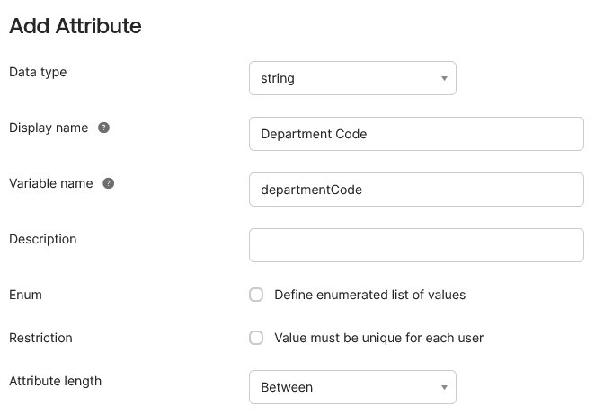 | Attribute Setup | Adding `departmentCode` as a custom string attribute |
| 02 | 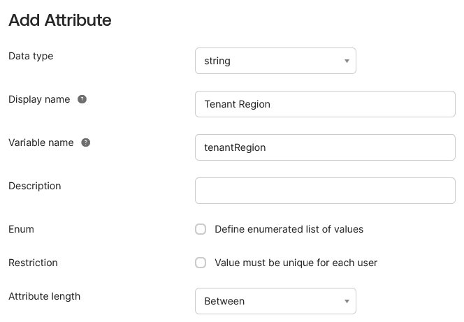 | Attribute Setup | Adding `tenantRegion` as a custom string attribute |
| 03 | 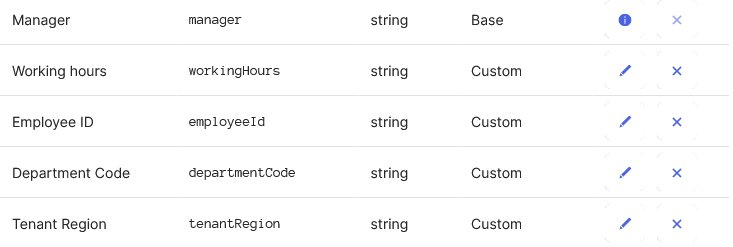 | Attribute Setup | All 4 custom attributes visible in Profile Editor |
| 04 | 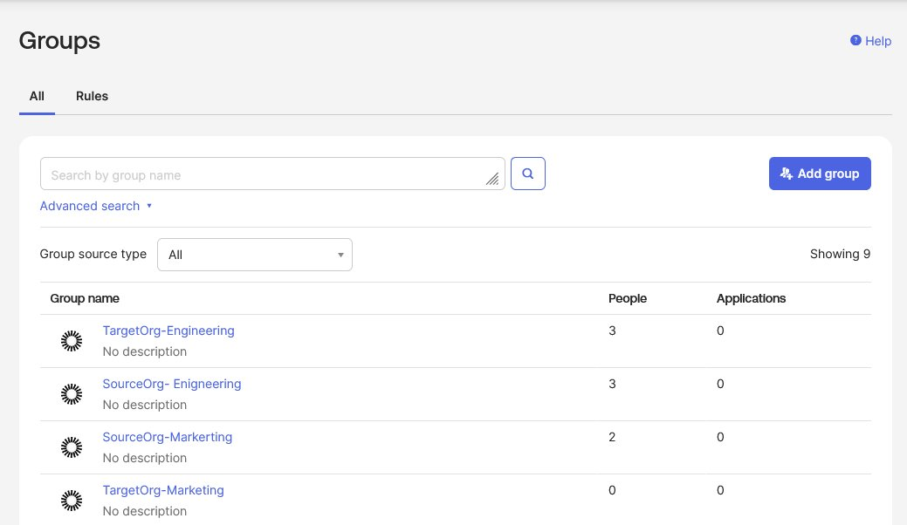 | Group Creation | 4 groups created — 2 Source, 2 Target |
| 05 | 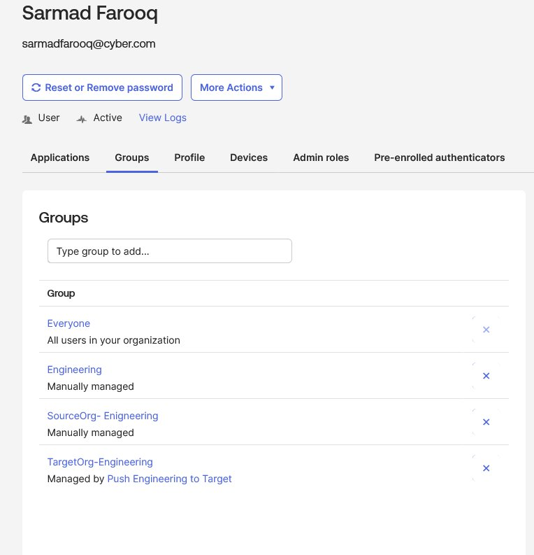 | User Assignment | User profile showing automatic TargetOrg group membership |
| 06 | 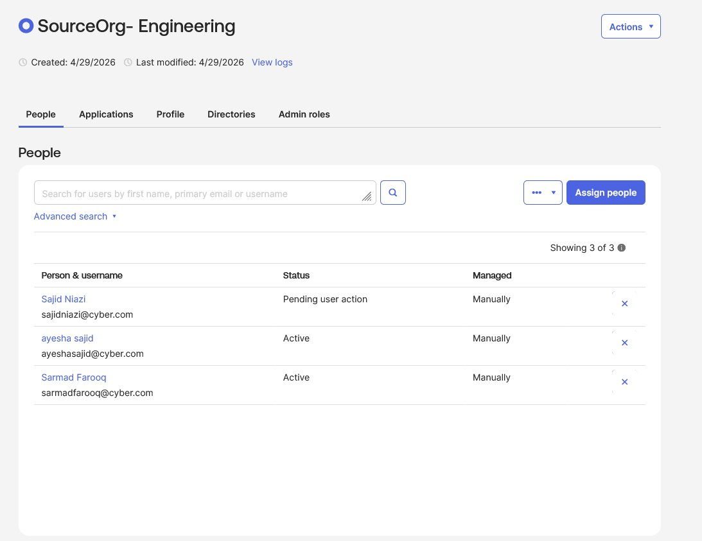 | User Assignment | SourceOrg-Engineering: 3 users manually assigned |
| 07 | 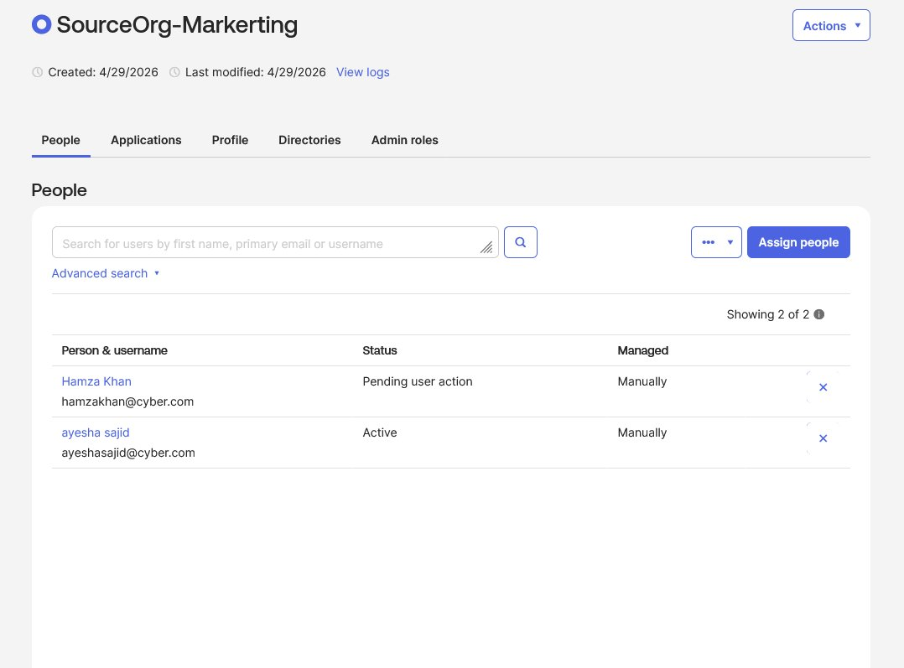 | User Assignment | SourceOrg-Marketing: 2 users manually assigned |
| 08 | 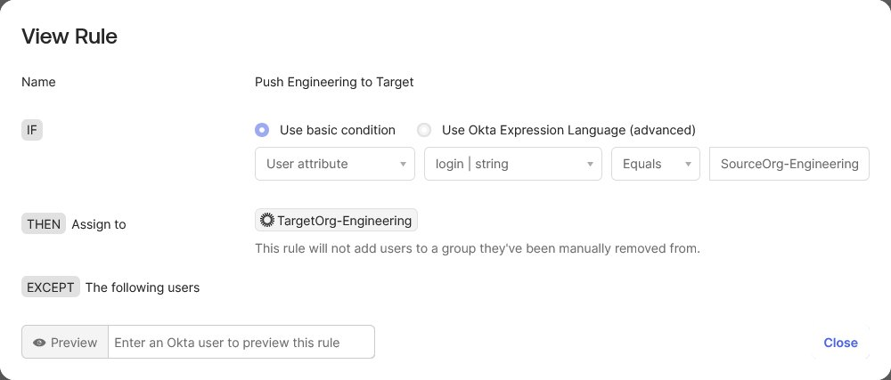 | Rule Config | "Push Engineering to Target" rule configuration |
| 09 |  | Rule Config | "Push Marketing to Target" rule configuration |
| 10 | 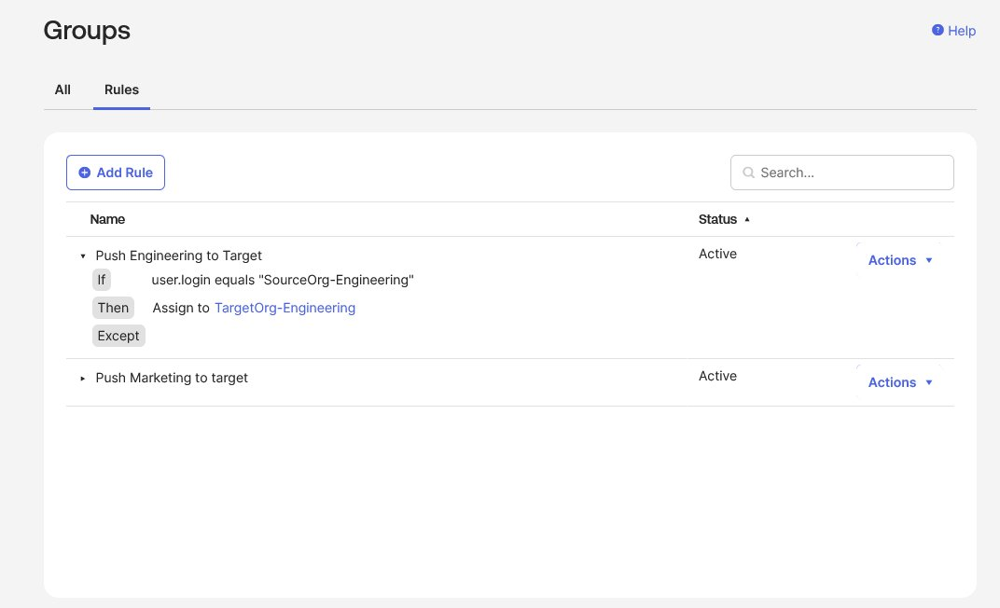 | Rule Config | Both rules shown Active in the Rules dashboard |
| 11 | 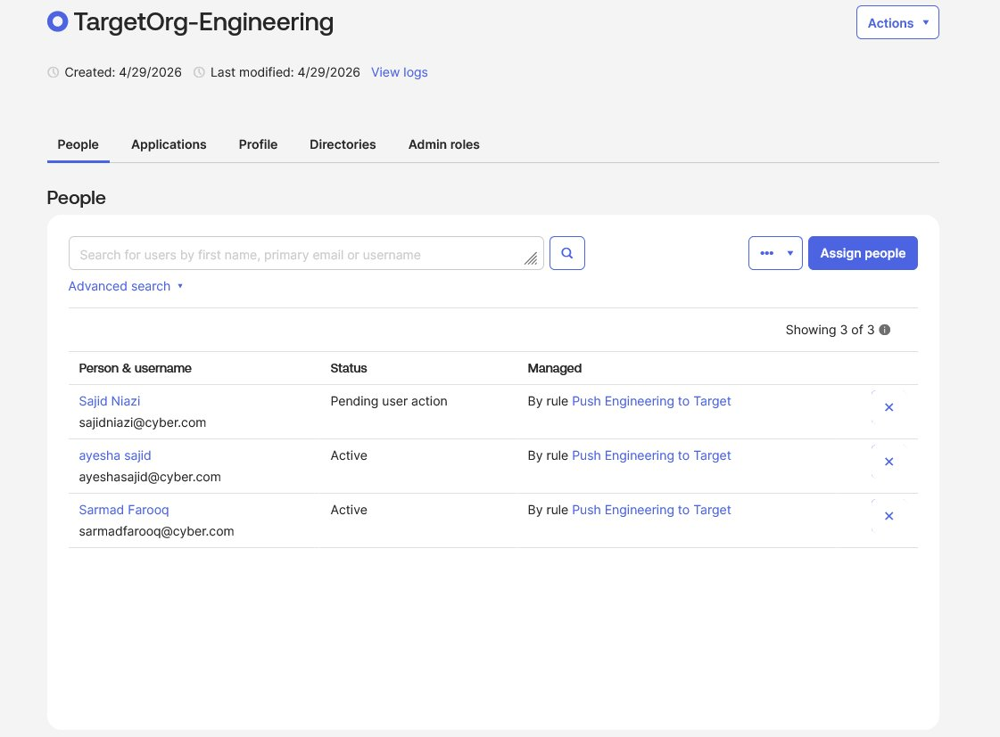 | Verification | TargetOrg-Engineering: 3 users auto-provisioned |
| 12 | 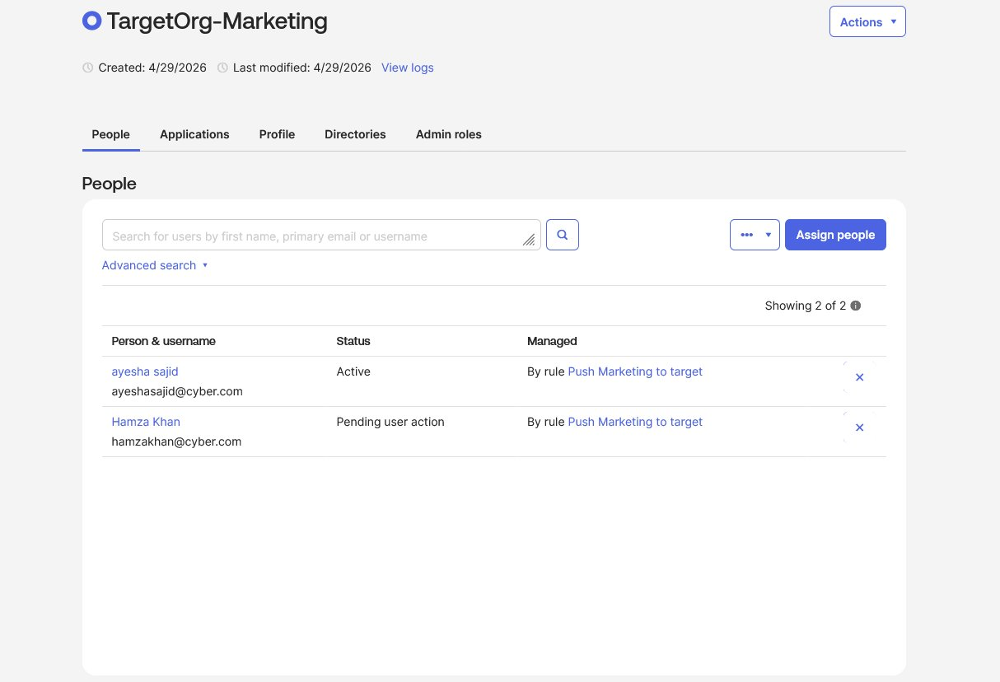 | Verification | TargetOrg-Marketing: 2 users auto-provisioned |
